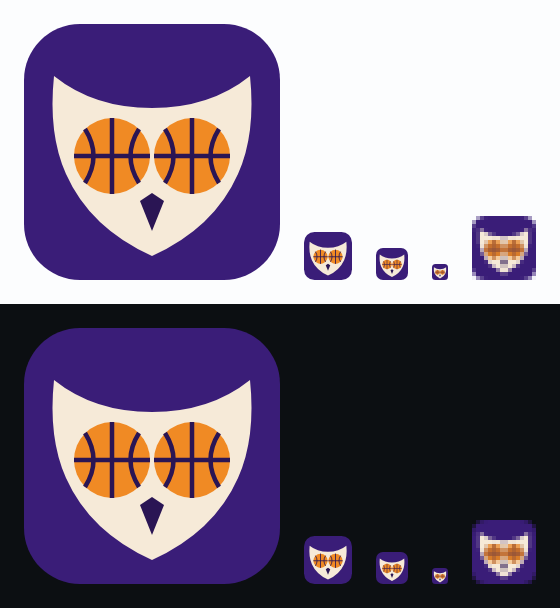

# The app icon

The mark is `build/icon.svg`: an owl's face with basketballs for eyes, cream on a violet rounded tile. The owner chose it for T1102. `npm run icon` draws every icon file from it (`scripts/make-icon.mjs`): `build/icon.ico` for Windows (16 to 256 px), `build/icon.png` for Linux (512 px) and `resources/icon.png` for the window (256 px). Edit the SVG, run the script, commit all four.

It is an original drawing: no league, team or broadcaster mark, and no league name (D31).

## How it looks small

The preview shows 256, 48, 32 and 16 px, then 16 px enlarged, on a light and a dark ground. `npx electron scripts/make-icon.mjs --sheet <out.png> build/icon.svg` draws it again.

At 32 px the seams on the eyes read as stripes and the two eyes touch. At 16 px the seams blur: the eyes merge into one orange band and the beak is a single dark pixel.
