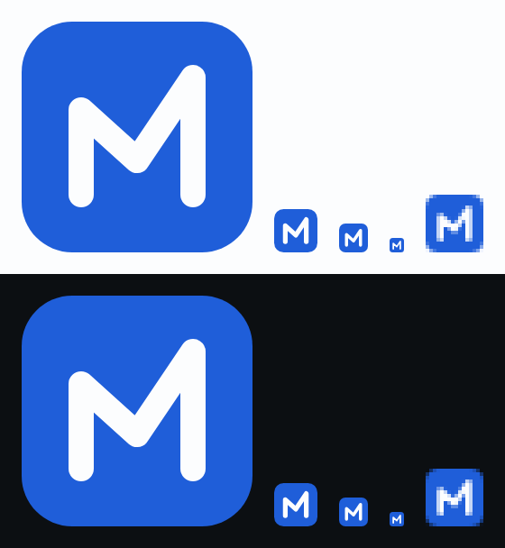
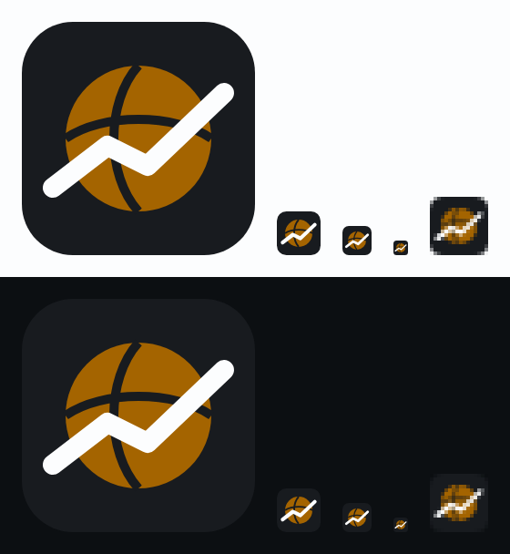
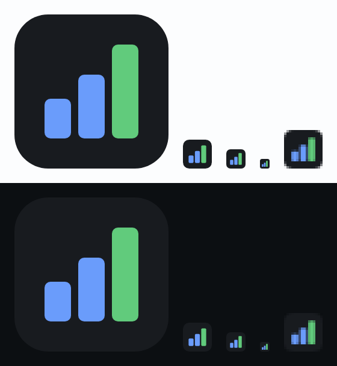

# The app icon

The mark is `build/icon.svg`: an M whose strokes are a line chart, its second peak higher than the first, in the stats palette's cobalt and paper. `npm run icon` draws every icon file from it (`scripts/make-icon.mjs`): `build/icon.ico` for Windows (16 to 256 px), `build/icon.png` for Linux (512 px) and `resources/icon.png` for the window (256 px). Edit the SVG, run the script, commit all four.

It is an original drawing: no league, team or broadcaster mark, no player, no icon-set glyph (D31).

## The candidates

Three were drawn for T1102. Each preview shows 256, 48, 32 and 16 px, then 16 px enlarged, on a light and a dark ground. `npx electron scripts/make-icon.mjs --sheet <out.png> <file.svg>` draws one.

**a. Monogram (chosen).** It keeps its shape at 16 px, and the letter ties it to the name.

**b. Ball and line.** A circle with two seams, crossed by a rising line. At 16 px the seams and the line merge.

**c. Columns.** Three rising columns, the last in the palette's green. Clear at 16 px, but it reads as a signal-strength indicator.

